# Alma — native iOS (SwiftUI)

Alma turns a photo of a room into a redesigned room furnished with real products from Israeli
stores. This repository is the native iOS app (SwiftUI, no third-party dependencies).

**On the App Store:** https://apps.apple.com/il/app/id6820282999 (version 1.1)

The app talks to the Alma backend (FastAPI) over HTTPS; the backend and the website live in a
separate repository.

## Screenshots

| Sign in | Your room | Which room? | Mark & tell | Colours | Result |
|---|---|---|---|---|---|
| 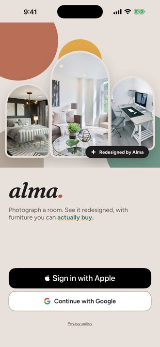 | 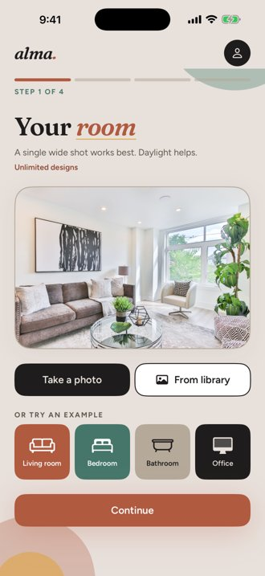 | 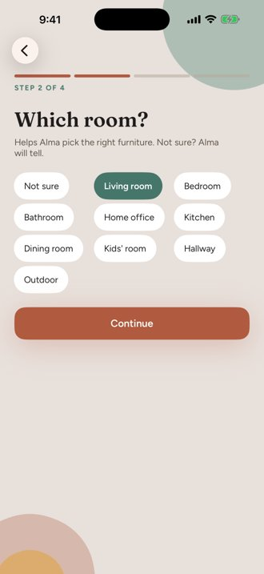 | 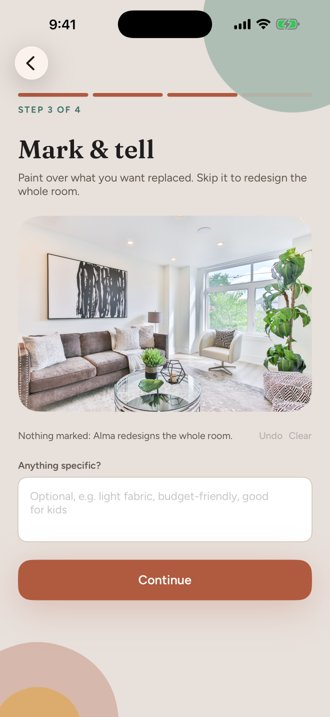 | 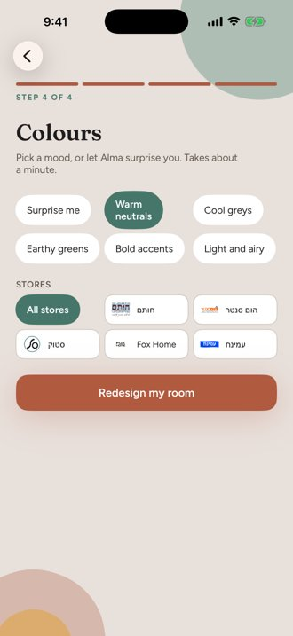 | 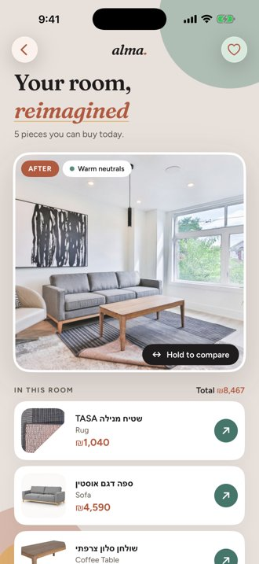 |
| 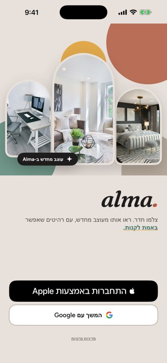 | 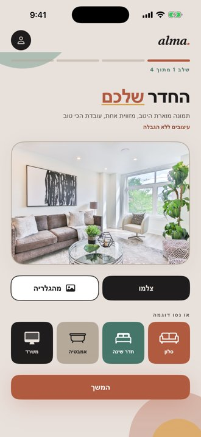 | 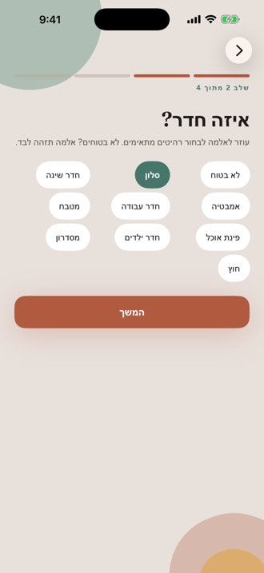 | 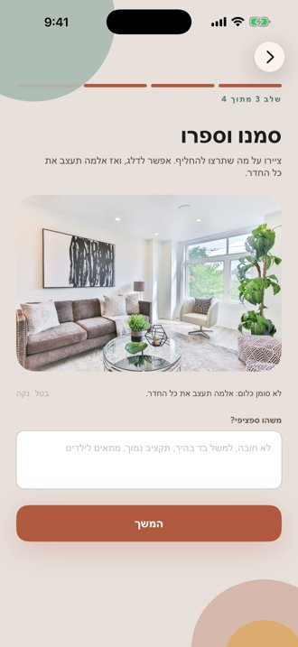 | 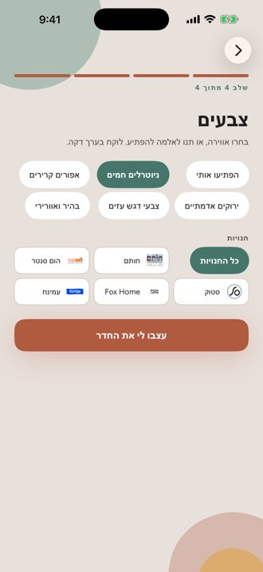 | 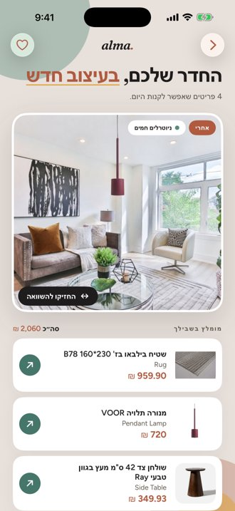 |

The result screen is real output from the production backend. Full-size App Store
screenshots (1320 x 2868) are in `store/screenshots/en/` and `store/screenshots/he/`.

## Video

[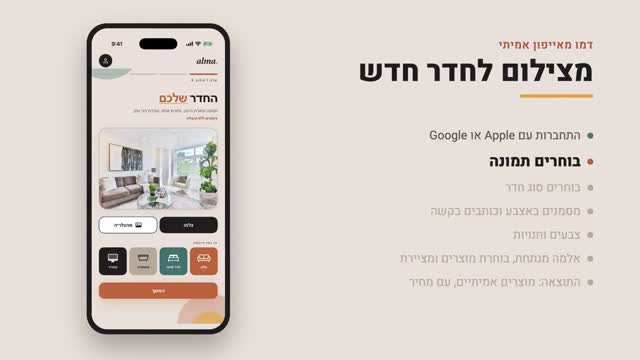](docs/media/alma-explainer-he.mp4)

A short explainer in Hebrew: how to shoot the room, a walkthrough of the app, how it is
built (SwiftUI, URLSession, Keychain), privacy, the AI pipeline on the server, and the road
to the App Store. Click the image to open the video.

## Documentation

| Document | What it covers |
|---|---|
| [docs/ARCHITECTURE.md](docs/ARCHITECTURE.md) | The app, the server and the outside services, and how they connect. |
| [docs/DESIGN_FLOW.md](docs/DESIGN_FLOW.md) | How a redesign works, from the photo to the AI pipeline on the server. |
| [docs/SERVER_API.md](docs/SERVER_API.md) | Every server endpoint the app calls, errors and tokens. |
| [docs/AUTH.md](docs/AUTH.md) | Sign in with Apple, Google sign-in with PKCE, sessions, account deletion. |
| [docs/PAYMENTS.md](docs/PAYMENTS.md) | Subscriptions with StoreKit 2 and server-side verification. |
| [docs/REFERENCES.md](docs/REFERENCES.md) | Apple documentation, standards (RFCs) and the services used. |

## Opening it

```
open Alma.xcodeproj
```

No package manager, no `pod install`, no code generation. The project uses Xcode 16
filesystem-synchronized groups, so files added to `Alma/` are picked up automatically
without editing the project file.

**Verified on 30.09.2026:** builds clean and launches on the iPhone 16 simulator under
Xcode 16.3 / Swift 6.1.

```
xcodebuild -project Alma.xcodeproj -scheme Alma \
  -destination 'platform=iOS Simulator,name=iPhone 16' build
```

## Requirements

- Xcode 16 or later
- iOS 17 deployment target — required for `@Observable` (the Observation framework)
  and `PhotosPicker`

## Layout

| File | Replaces (RN) | Notes |
|---|---|---|
| `AlmaApp.swift` | `app/_layout.tsx`, `app/(main)/_layout.tsx` | `NavigationStack` + `NavigationPath` |
| `Theme.swift` | `src/theme/index.ts` | identical palette to almapic.com |
| `Models.swift` | type unions in `src/api/client.ts` | TS string unions → Swift enums |
| `AlmaAPI.swift` | `src/api/client.ts` | `URLSession`, hand-rolled multipart |
| `SessionStore.swift` | `src/state/session.ts` | Zustand → `@Observable`; Keychain |
| `WizardStore.swift` | `src/state/wizard.ts` | Zustand → `@Observable` |
| `Keychain.swift` | `expo-secure-store` | Security framework |
| `Components.swift` | `src/components/*` | Button, ErrorBanner, StepIndicator, Chip |
| `Views/LandingView.swift` | `app/index.tsx` | Apple + Google sign-in |
| `Views/UploadView.swift` | `app/(main)/step-1-upload.tsx` | `PhotosPicker` |
| `Views/StyleView.swift` | `app/(main)/step-2-style.tsx` | room + palette |
| `Views/ReviewView.swift` | `app/(main)/step-3-review.tsx` | confirm + submit |
| `Views/ResultView.swift` | `app/(main)/step-4-result.tsx` | redesign + product cards |

## Dependencies

None. The Expo build has 29 runtime packages; this has zero. Everything is a platform
framework: SwiftUI, Observation, PhotosUI, AuthenticationServices, CryptoKit, Security.

## Configuration

Values in `Alma/Info.plist`:

- `AlmaAPIBaseURL` — backend origin, mirrors `extra.apiBaseUrl` in `app.json`.
- `AlmaGoogleClientID` — the iOS OAuth client (no secret). Its reversed form is
  registered in `CFBundleURLTypes` and used as the redirect scheme, because Google iOS
  clients reject custom schemes like `alma://`. If emptied, the Google button hides.
- `AlmaPrivacyURL`, `AlmaSupportURL` — linked from the sign-in screen and the account
  menu.

Version is `MARKETING_VERSION` / `CURRENT_PROJECT_VERSION` in the project (1.0.0, build 1).
The app is iPhone-only (`TARGETED_DEVICE_FAMILY = 1`).

## App Store readiness

- Guests can use the whole flow ("Continue without an account"); `POST /design` does
  not need a token.
- Signed-in users can delete their account from the account menu (`DELETE /users/me`).
  Apple accounts re-confirm with Apple first so the backend can revoke the link.
- Before the first upload the app asks permission to send the photo to OpenAI and
  Google (guideline 5.1.2(i)); the answer is remembered.
- Sign in with Apple needs `POST /auth/apple/callback`, which exists on the backend's
  `appstore-prep` branch only until that is deployed.
- Listing text, privacy answers and screenshots: `store/`.

## Taking the screenshots

Debug builds accept launch arguments that drive the real wizard (compiled out of
Release, see `ScreenshotDriver.swift`). The simulator must be signed in first.

```
xcrun simctl launch booted com.arielhalevy.alma \
  -AlmaDemoPhoto /path/to/room.jpg -AlmaDemoStep upload|room|mark|palette|result
```

Add `-AppleLanguages "(he)" -AppleLocale he_IL` for Hebrew. `result` calls the
production backend and takes about a minute. Build the simulator app with `xcodebuild`
(not an unsigned copy), so the Keychain works and the sign-in survives a relaunch.

## Tests

```
xcodebuild -project Alma.xcodeproj -scheme Alma \
  -destination 'platform=iOS Simulator,name=iPhone 16' test
```

**25 tests, 0 failures** (verified 07.10.2026).

- `DecodingTests` (15) pin the wire contract: `price_ils` arriving as both `1290` and
  `249.9`, `product_id` as both number and string, `generated_image_url` winning over
  `image_url`, an absent `status` meaning done, and the exact raw values the backend
  expects for every room and palette.
- `WizardStoreTests` (7) cover the state rules — in particular that choosing a new
  photo drops the previous redesign, and that "try another look" keeps the photo while
  "start over" does not.

## Localisation

Hebrew and English ship in `Localizable.xcstrings` (63 strings), using the product's
own wording from `src/i18n/he.ts` wherever an equivalent exists. Verified rendering
right-to-left on the simulator under `-AppleLanguages '(he)'`.

One wording fix: the RN source reads `המשך בהמשך פירושו הסכמה…`, which looks like a
slip. This build uses `המשך פירושו הסכמה…`. Worth correcting in the RN app too.

## Known gaps

Stated plainly rather than left to be discovered:

1. **Google sign-in needs `GOOGLE_IOS_CLIENT_ID` on the backend** (Railway), equal to
   `AlmaGoogleClientID`; without it `/auth/google/callback` answers 503. The Expo
   build still has no Google client (`expo.extra.googleClientId` is absent from
   `app.json`).
2. **Signed-in flow not exercised end to end.** The guest flow was run against the
   production backend (07.10.2026). Sign in with Apple needs a real Apple ID on a
   device and the backend's Apple endpoint deployed.
3. **The app icon is functional, not designed.** `icon-1024.png` is a Fraunces "A" in
   alma-earth inside a terracotta ring on alma-cream — generated, on-brand, and legible
   at small sizes, but it is not the work of a designer.

## One behaviour that is deliberately different

`ResultView` cancels its polling task in `onDisappear`. The RN implementation leaves
its interval running when the user backs out mid-poll. That was not copied over.
