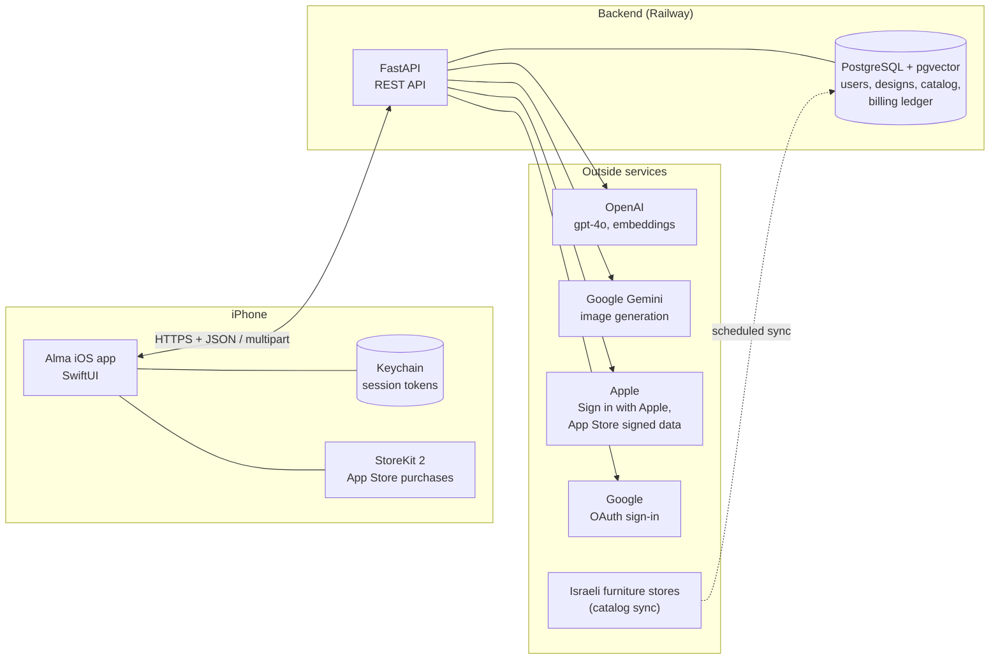

# Architecture

Alma has three parts: this iOS app, a backend server, and the outside services the
backend calls. The app never talks to the AI services or the store catalogs directly;
everything goes through the backend over HTTPS.

## The iOS app

Native SwiftUI, iOS 17 and later, iPhone only. No third-party packages: only Apple
frameworks (SwiftUI, Observation, PhotosUI, AuthenticationServices, StoreKit,
CryptoKit, Security).

| File | Role |
|---|---|
| `AlmaApp.swift` | Entry point. Restores the session from the Keychain, listens for App Store transactions, sets up navigation. |
| `AlmaAPI.swift` | Every network call to the backend: a small `URLSession` client with JSON and hand-built multipart uploads. |
| `SessionStore.swift` | Who is signed in. Sign in with Apple, Google sign-in (OAuth with PKCE), token refresh, sign-out, account deletion. |
| `Keychain.swift` | Stores the session tokens in the iOS Keychain, readable only by this app. |
| `StoreManager.swift` | StoreKit 2 purchases: loads products, buys, restores, and sends every transaction to the server to be verified. |
| `WizardStore.swift` | State of the four-step redesign wizard (photo, room, marks, palette) and the request it builds. |
| `Models.swift` | The data types that match the server's JSON. |
| `Theme.swift`, `Components.swift` | Colours, fonts and shared UI pieces. |
| `Views/` | One file per screen: `LandingView` (sign-in), `UploadView` (photo), `RoomView`, `MarkView` (draw on the photo), `PaletteView`, `ResultView`, `MyDesignsView`, `PaywallView`. |
| `Localizable.xcstrings` | Hebrew and English text. |

State uses the Observation framework (`@Observable` classes): SwiftUI tracks which
properties each view reads and redraws only those views.

## The backend

A Python FastAPI service hosted on Railway, with a PostgreSQL database that has the
pgvector extension. The same backend also serves the Alma website (almapic.com). It
lives in a separate repository; this document describes the parts the app uses.

| Area | What it does |
|---|---|
| `auth` | Exchanges an Apple identity token or a Google authorisation code for Alma's own tokens: a short-lived access token (15 minutes) and a refresh token. |
| `design` | Receives the photo and hints, runs the AI pipeline, returns the redesigned image with real products. See [DESIGN_FLOW.md](DESIGN_FLOW.md). |
| `rooms` | Saves, lists, renames and deletes the user's designs ("My designs"). |
| `catalog` | The product catalog: thousands of products from Israeli furniture stores, each with a text embedding for similarity search. |
| `billing` | Plans, the user's balance of designs, and verification of App Store purchases. See [PAYMENTS.md](PAYMENTS.md). |
| `users` | Usage counters and account deletion. |

Full list of endpoints: [SERVER_API.md](SERVER_API.md).

## Design decisions

- **The server is the source of truth.** Free designs, subscription balances and
  purchases are counted on the server, per account. The app only displays them, so
  reinstalling the app or switching devices cannot reset or duplicate them.
- **No secrets in the app.** The only identifiers in the app are public by design (the
  backend address and the Google iOS client ID, which every iOS app with Google sign-in
  ships). API keys for OpenAI and Gemini live only on the server.
- **Sign-in is required to design,** because designs and payments belong to an account
  (App Store guideline 5.1.1(v)).
- **Permission before AI.** Before the first design, the app asks the user's permission
  to send the photo for AI processing (guideline 5.1.2(i)).
