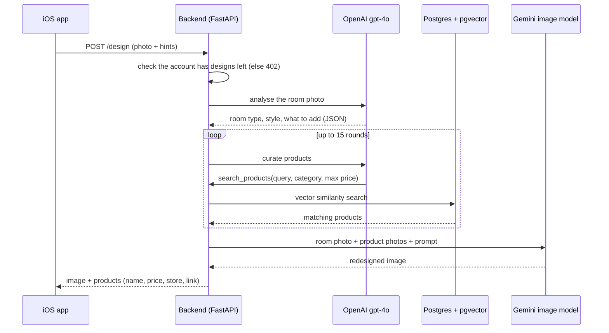

# How a redesign works

## In the app: a four-step wizard

1. **Photo** (`UploadView`): take a photo or pick one from the library. The app resizes
   it and encodes it as JPEG. This is the only required step.
2. **Room** (`RoomView`): optionally say which room it is.
3. **Mark & tell** (`MarkView`): optionally draw on the parts of the photo to change and
   write what you want. The strokes are flattened onto a copy of the photo
   (`marked_image`).
4. **Palette** (`PaletteView`): optionally pick colours and stores.

`WizardStore` keeps the answers between steps. A new photo clears the old marks and
result, so a design never mixes inputs from two photos.

## On the server: one request

1. **Room analysis.** gpt-4o looks at the photo and returns structured JSON: the room
   type, its current style, a colour palette, the furniture already there, and a list of
   items to add, each with a description, colour and placement.
2. **Product curation.** gpt-4o runs a tool loop (at most 15 rounds). Its main tool,
   `search_products`, turns a descriptive query ("light grey fabric 3-seat sofa,
   Scandinavian, wooden legs") into an embedding and finds the closest real products in
   the catalog with pgvector cosine similarity, filtered by category, price and the
   stores the user picked.
3. **Image generation.** The Gemini image model (`gemini-3.1-flash-lite-image`) gets the
   room photo, clean photos of the chosen products (so it draws the real items, not
   look-alikes) and a prompt built from the analysis and the user's hints, and returns the
   redesigned room.
4. **Response.** The image and the list of real products, each with its price, store and
   a link to the store's own page, where any purchase happens. Alma itself sells no
   furniture.

## The catalog (offline, on a schedule)

- A sync job reads the stores' public product feeds every few hours, adds new products,
  updates prices and marks removed products as out of stock. A guard stops the update
  if a store suddenly returns far fewer products than last time.
- Each new product's photo and details go to gpt-4o vision, which writes a rich English
  description (colour, material, style).
- That description is embedded with `text-embedding-3-small` (1536 dimensions) and stored
  in a pgvector column with an IVFFlat index, which is what the similarity search uses.

## After the result

- **Save** (`ResultView`): creates a room (`POST /rooms`) and attaches the design
  (`POST /rooms/{id}/designs`). Leaving an unsaved result asks for confirmation.
- **My designs** (`MyDesignsView`): lists saved designs (`GET /rooms/designs/latest`),
  with rename and delete.
- If the server ever answers "pending" or "processing" instead of a finished design, the
  result screen polls `GET /design/{id}` every 2 seconds for up to about two minutes.
