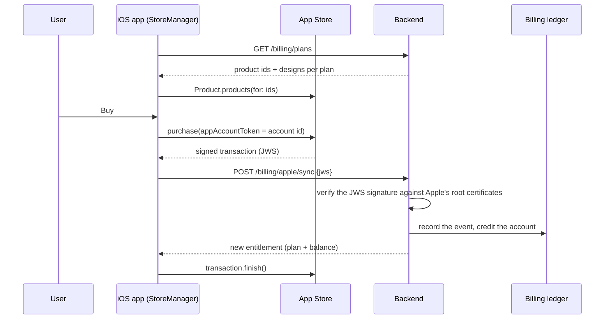

# Payments (StoreKit 2)

Version 1.1 sells three monthly subscriptions (Alma Starter, Plus and Pro, each a
number of designs per month) and a one-time pack of 3 extra designs. Everything is sold
through the App Store with StoreKit 2, as guideline 3.1.1 requires for digital content;
the app has no link or hint to pay anywhere else.

## Rule: the App Store sells, the server decides

1. **Products come from the server** (`GET /billing/plans`), not from the app, so plans
   and allowances can change without an app update.
2. **Purchase.** `product.purchase(options: [.appAccountToken(...)])` ties the purchase
   to the Alma account.
3. **Verification on the server.** The app sends the transaction's JWS (a token Apple
   signed) to `POST /billing/apple/sync`. The server verifies it with Apple's
   [App Store Server Library](https://github.com/apple/app-store-server-library-python)
   (`SignedDataVerifier`) against Apple's root certificates, checks the bundle id, then
   writes an event to the billing ledger and credits the account.
4. **Finish only after the server accepts.** A transaction the server has not accepted
   stays unfinished, so StoreKit offers it again on the next launch and the customer
   never loses what they paid for.
5. **Renewals and purchases made elsewhere** arrive through `Transaction.updates`, which
   the app listens to from launch, and go through the same sync.
6. **Restore Purchases** re-syncs with the App Store and credits every active
   subscription. The server is idempotent: it never refills a month it already counted.

## Free designs

Every account gets 3 free designs. When they run out, `POST /design` answers 402 and the
app shows the paywall (`PaywallView`).

## Testing

`Alma.storekit` is a local StoreKit configuration with the same products, so purchases
can be tested in the simulator without a real App Store account. `AlmaTests/BillingTests`
checks that every plan's product id is loaded.
